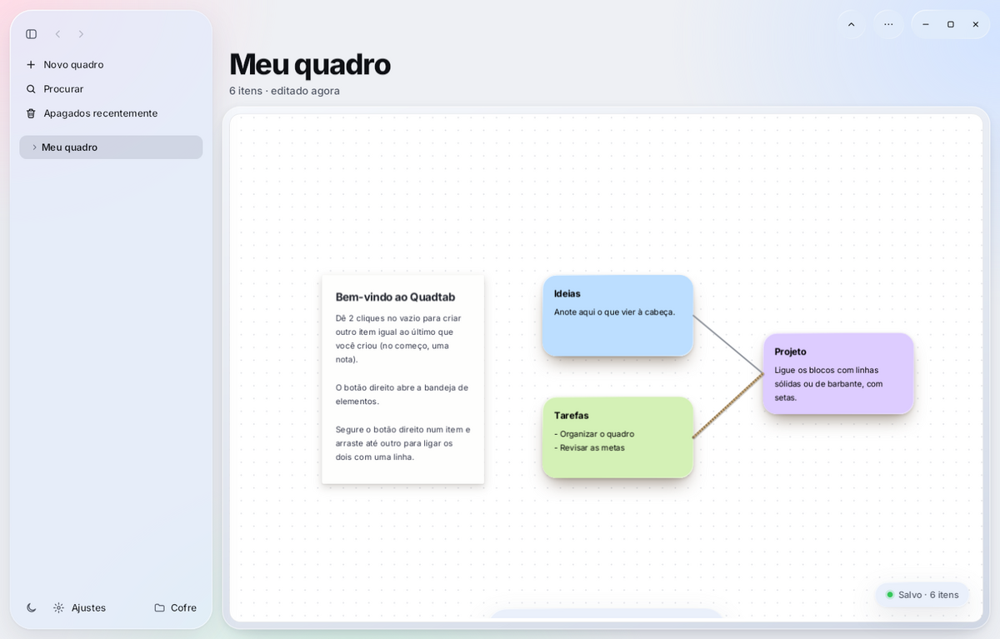
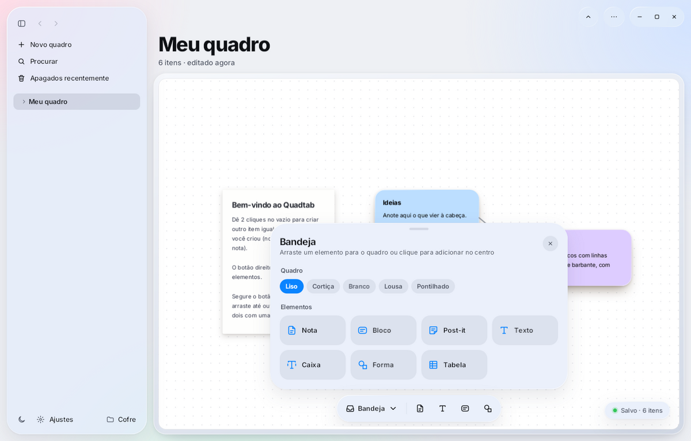
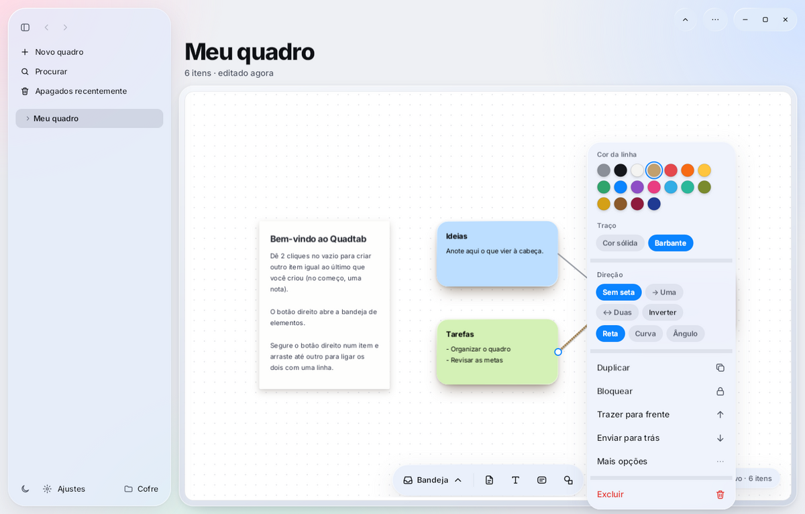
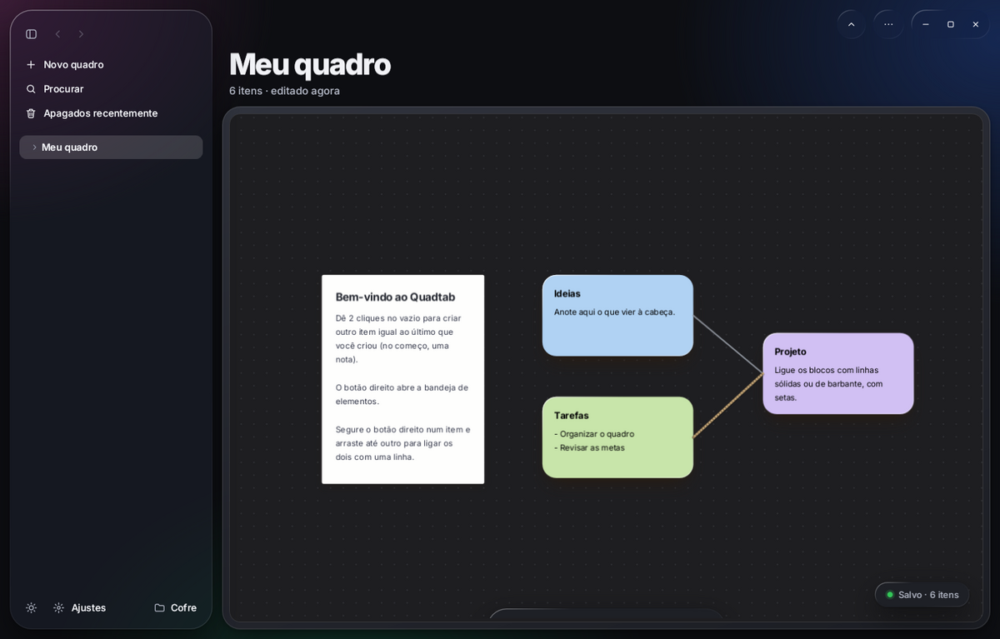

# Quadtab

Quadro visual infinito para Windows: cole notas, post-its, blocos, formas e imagens, arraste tudo livremente e ligue as ideias com linhas e setas.



## Baixar

Baixe o `Quadtab.exe` na [página de versões](https://github.com/Vitorgabrielqzs/quadtab/releases/latest) e abra. Não precisa instalar nada.

Windows 10 (1809 ou mais novo) ou Windows 11, 64 bits.

## Recursos

- **Quadro infinito** com zoom de 10% a 400%.
- **5 modelos de quadro:** Liso, Cortiça, Branco, Lousa e Pontilhado.
- **Elementos:** notas, post-its, blocos, textos, caixas, formas, tabelas, desenho, imagens, vídeos, arquivos e links.
- **Linhas e setas** entre quaisquer itens (inclusive outras linhas), retas, curvas ou em ângulo, em cor sólida ou barbante.
- **Notas em Markdown**, editadas direto no quadro.
- **Vários quadros**, com pastas, galeria e lixeira de 30 dias.
- **Busca, apresentação e exportação** em PNG ou PDF.
- **Tema claro e escuro**, com painéis de vidro.

| Bandeja de elementos | Linhas e setas |
|---|---|
|  |  |



## Atalhos

| Atalho | Ação |
|---|---|
| 2 cliques no vazio | Cria outro item igual ao último |
| 2 cliques num item | Edita o texto |
| Botão direito | Bandeja ou menu do item |
| Botão direito + arrastar de um item a outro | Cria uma linha |
| Arrastar no vazio | Move o quadro |
| Rodinha | Zoom |
| Enter / Shift+Enter | Sai da edição / quebra a linha |
| Ctrl+N · Ctrl+K · Ctrl+F | Novo quadro · Procurar · Buscar no quadro |
| Ctrl+Z / Ctrl+Shift+Z | Desfazer / refazer |
| F11 | Tela cheia |

## Dados

Tudo fica em `Documentos\Cofre`, salvo automaticamente:

```
Quadros\    um arquivo .quadtab (JSON) por quadro
Notas\      cada nota é um arquivo .md
Anexos\     imagens, vídeos e arquivos
.lixeira\   itens apagados (30 dias)
```

## Compilar

Precisa do [SDK do .NET 10](https://dotnet.microsoft.com/download/dotnet/10.0) no Windows.

```bash
dotnet run --project Quadtab
```

```bash
dotnet publish Quadtab -c Release -r win-x64 --self-contained true -p:PublishSingleFile=true
```

O `.exe` sai em `Quadtab\bin\Release\net10.0-windows10.0.19041.0\win-x64\publish\`.

Feito em C#, .NET 10 e WPF (MVVM, [CommunityToolkit.Mvvm](https://github.com/CommunityToolkit/dotnet)). Fontes [Inter](https://github.com/rsms/inter) e [Nunito](https://github.com/googlefonts/nunito) sob a licença SIL OFL (textos em `Quadtab/Assets/Fonts`).
